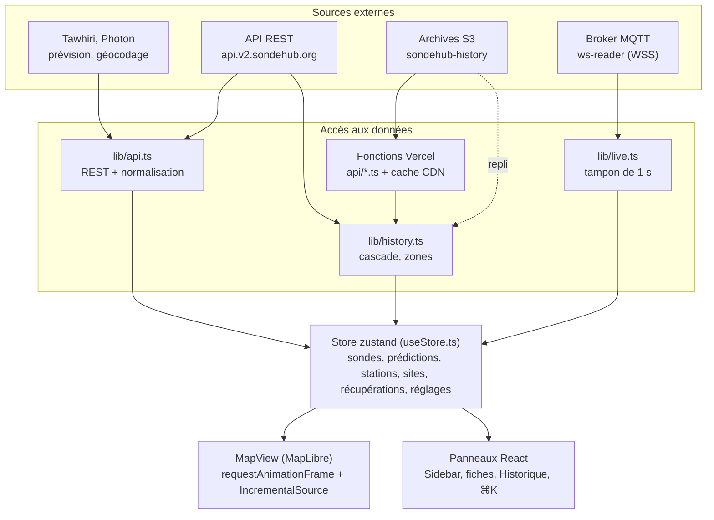
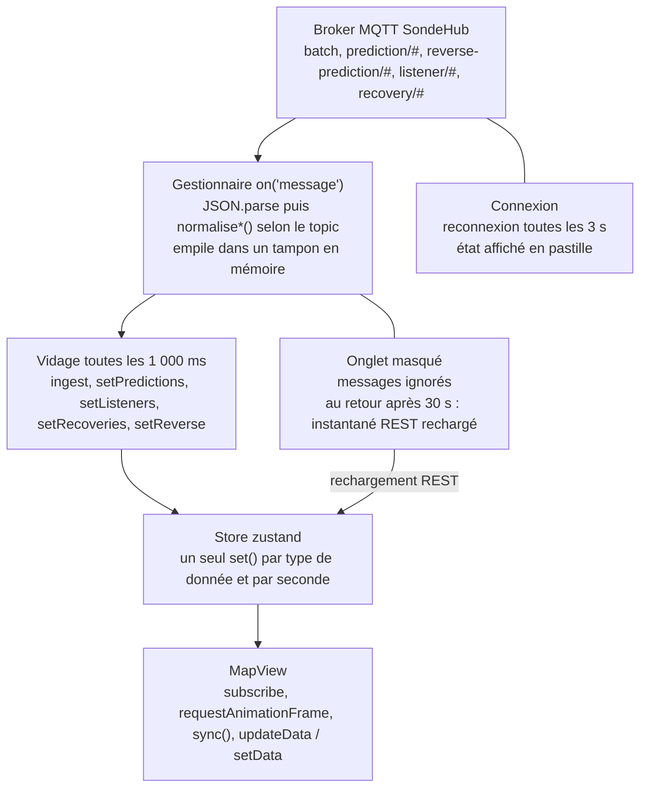
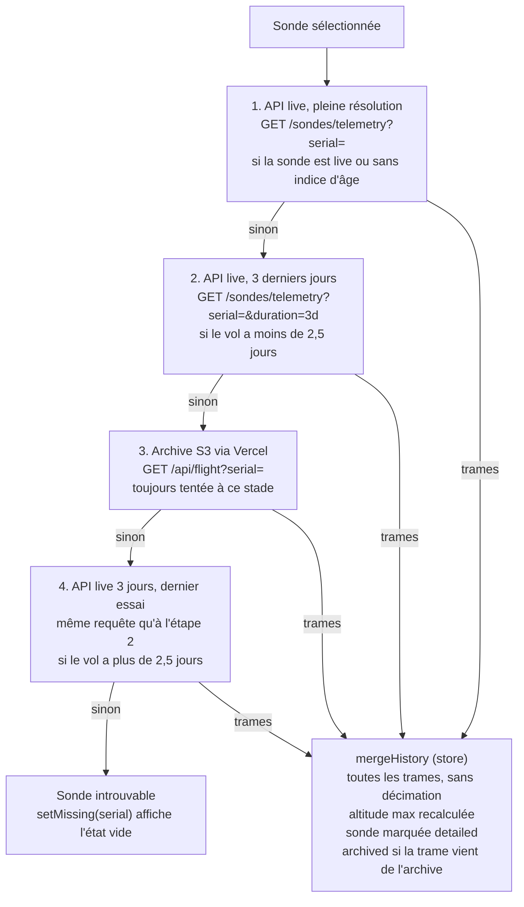
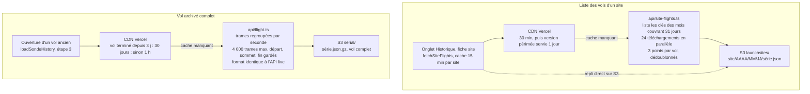

# SondeHub V2 — Récupération des données et architecture

15/10/2026 · Joris

## Vue d'ensemble

SondeHub V2 est une SPA React qui interroge directement les services publics de SondeHub depuis le navigateur, sans backend propre ni clé d'API. Les seules exceptions sont deux fonctions Vercel dans `api/`, qui lisent et allègent les archives S3 pour l'historique.

Le modèle de données repose sur trois mécanismes complémentaires :

- **Instantané REST** au chargement : télémétrie de la période choisie (1 h à 1 j), prédictions, stations, sites de lâcher.
- **Flux temps réel MQTT** sur WebSocket : chaque trame est tamponnée puis appliquée au store une fois par seconde.
- **Chargements à la demande** : historique complet d'une sonde sélectionnée, vols archivés, prévisions Tawhiri d'un site, recherche de lieu.

Tout converge vers un store unique zustand (`src/store/useStore.ts`), que la carte et les panneaux lisent.



Les flèches vont toujours vers le bas : aucune vue n'écrit dans une source. Le pointillé est le repli direct sur S3 quand les fonctions Vercel ne répondent pas.

| Couche | Technologie |
| --- | --- |
| UI | React 19, shadcn/ui (Radix), Tailwind 4, vaul (tiroir mobile), cmdk (⌘K) |
| État | zustand 5, réglages persistés dans `localStorage` |
| Carte | MapLibre GL 6, sources GeoJSON, relief Mapterhorn |
| Temps réel | mqtt.js (chargé à la demande) |
| Graphiques et 3D | uPlot, Three.js (chargé à la demande) |
| Build et hébergement | Vite 8 (Rolldown), TypeScript 7, Vercel |
| Langues | i18n maison, 13 locales en JSON chargées à la demande |

## Sources de données

L'application consomme six familles de services ; seule l'API REST SondeHub et le flux MQTT alimentent le suivi en direct, le reste sert à l'historique, aux prévisions et au fond de carte.

| Appel | Rythme | Donnée obtenue | Code |
| --- | --- | --- | --- |
| `GET /sondes/telemetry?duration=1h…1d` | Au chargement, au changement de période, au retour sur l'onglet après 30 s | Trames de toutes les sondes, décimées par l'API | `lib/api.ts` |
| `GET /predictions` | Toutes les 60 s | Trajectoire prédite, éclatement, point d'atterrissage | `lib/api.ts` |
| `GET /predictions/reverse` | Avec la télémétrie | Site et heure de lâcher estimés | `lib/api.ts` |
| `GET /listeners/telemetry?duration=1d` | Une fois | Stations réceptrices, dernière position de chacune | `lib/api.ts` |
| `GET /sites` | Une fois | Sites de lâcher, horaires, profils de vol | `lib/api.ts` |
| `GET /recovered?last=259200` | Quand le calque Récupérations est activé | Récupérations des 3 derniers jours | `lib/api.ts` |
| `GET /sondes/telemetry?serial=` | À la sélection d'une sonde | Historique pleine résolution | `lib/history.ts` |
| `GET /sondes?lat=&lon=&distance=&last=` | Onglet Historique | Derniers signaux autour d'un point | `lib/history.ts` |
| `GET /tawhiri?...` | Fiche site | Prévision d'un lâcher futur (montée, descente) | `lib/api.ts` |
| `PUT /recovered` | Après confirmation de l'utilisateur | Publication d'un signalement de récupération | `lib/api.ts` |
| `wss://ws-reader.v2.sondehub.org/` | Connexion permanente | Trames, prédictions, stations, récupérations en direct | `lib/live.ts` |
| `/api/site-flights`, `/api/flight` | Onglet Historique, vol archivé | Résumés et vols complets tirés de S3 | `api/*.ts` |
| S3 `sondehub-history` | Repli si `/api/` absent | Archives brutes (`launchsites/`, `serial/`) | `lib/api.ts`, `api/*.ts` |
| Photon (komoot) | Recherche de lieu | Géocodage direct et inverse | `lib/watchPoint.ts` |
| OpenFreeMap, Esri, OpenTopoMap, OSM, Mapterhorn | Tuiles à la volée | Fonds de carte, MNT pour le relief | `lib/basemaps.ts`, `lib/terrain.ts` |

Les chemins REST sont relatifs à `https://api.v2.sondehub.org`. Le CORS est ouvert, donc le navigateur appelle l'API sans proxy.

## Démarrage

Au chargement, `App.tsx` lance en parallèle quatre requêtes REST et la connexion MQTT, puis quatre minuteries entretiennent les données.

1. `main.tsx` charge la langue (`initI18n`) avant le premier rendu, puis monte `App`, Vercel Analytics et Speed Insights.
2. La carte s'ouvre sur la région déduite du fuseau horaire du navigateur (`lib/region.ts`), sans demander la géolocalisation.
3. Effet lié à la période : `fetchTelemetry(duration)` puis `loadTelemetry(data, true)` remplace les sondes ; `fetchReverse` en parallèle.
4. Effet unique : `fetchSites`, `fetchListeners`, `fetchPredictions` et `startLiveFeed()`.
5. Si l'URL contient `#s=SERIE`, la sonde est sélectionnée et la caméra la rejoint dès qu'elle apparaît dans le store.

| Minuterie | Période | Rôle |
| --- | --- | --- |
| Vidage MQTT | 1 s | Applique les trames et messages tamponnés au store |
| Débit | 1 s | Messages par seconde, moyenne glissante sur 10 s |
| `tick()` | 5 s | Recalcule les phases, purge les sondes sorties de la période |
| Prédictions | 60 s | Recharge `GET /predictions` en entier |

Toutes les requêtes portent un `AbortController` : changer de période ou démonter le composant annule les appels en cours.

## Temps réel (MQTT)

`lib/live.ts` s'abonne à cinq topics du broker SondeHub et ne pousse les messages dans le store qu'une fois par seconde, pour qu'une rafale de centaines de trames ne provoque qu'un seul rendu.



Le vidage à 1 s est le point clé : il découple le débit du broker du rythme des rendus React et MapLibre.

| Topic | Contenu | Normalisation | Action du store |
| --- | --- | --- | --- |
| `batch` | Tableau de trames de télémétrie groupées | Aucune (format `Frame`) | `ingest(frames)` |
| `prediction/#` | Une prédiction par sonde | `normalisePrediction` | `setPredictions(p, false)` |
| `reverse-prediction/#` | Lieu de lâcher estimé | `normaliseReverse` | `setReverse(r, false)` |
| `listener/#` | Position d'une station | `normaliseListener` | `setListeners(l)` |
| `recovery/#` | Signalement de récupération | `normaliseRecovery` | `setRecoveries(r, false)` |

Le topic `batch` est préféré à `sondes/#` parce qu'il regroupe les trames : beaucoup moins de messages pour le même contenu.

Points de conception :

- **Import dynamique** de `mqtt` : la bibliothèque n'est pas dans le bundle initial.
- **Reconnexion** toutes les 3 s, délai de connexion 15 s, keepalive 60 s ; l'état `connecting` / `live` / `offline` alimente la pastille de statut.
- **Onglet caché** : les messages sont ignorés. Au retour après plus de 30 s, `App.tsx` recharge l'instantané REST pour combler le trou.
- **Normalisation partagée** : REST et WebSocket passent par les mêmes fonctions `normalise*` de `lib/api.ts`, qui absorbent les différences de format (`vehicle` contre `serial`, `data` en chaîne JSON ou en tableau).

## Store et modèle de données

Le store zustand indexe tout par clé (série, indicatif, identifiant de site) et transforme chaque trame brute en un objet `Sonde` compact, avec une trace à tableaux de nombres plutôt qu'à objets.

| Champ du store | Clé | Source |
| --- | --- | --- |
| `sondes` | série | REST télémétrie, MQTT `batch`, historique à la demande |
| `predictions` | série | REST toutes les 60 s, MQTT `prediction/#` |
| `predHistory` | série | Dérivé : 240 dernières prédictions d'atterrissage (fiabilité de la prévision) |
| `reverse` | série | REST et MQTT `reverse-prediction/#` |
| `listeners` | indicatif | REST une fois, MQTT `listener/#` |
| `sites` | liste | REST une fois |
| `recoveries` | série | REST si le calque est actif, MQTT `recovery/#` |
| `settings` | — | `localStorage` (`sondetrack.settings.v1`) |

Une `Sonde` contient la dernière trame fusionnée (`last`), sa trace (`track`), l'altitude maximale et son index, les récepteurs qui l'ont entendue, et sa phase. Chaque point de trace est un tuple `[lon, lat, alt, epochMs, temp, humidité, vitesse verticale, pression]`, les capteurs absents valant `NaN`.

Ce que fait `applyFrame` à chaque trame :

1. Rejette les trames sans coordonnées finies ou en (0, 0).
2. Nettoie les capteurs absents : température ≤ −270 °C et pression ≤ 0 deviennent `NaN`.
3. Insère le point dans l'ordre chronologique ; une trame en retard est placée par recherche dichotomique, les doublons sont ignorés.
4. **Décime** les sondes non sélectionnées à un point toutes les 10 s ; la sonde sélectionnée garde tous ses points.
5. Met à jour l'altitude max, fusionne les champs de `last` (certains décodeurs omettent des champs) et enregistre le récepteur avec son SNR.

La phase est recalculée à chaque trame et toutes les 5 s par `tick()` :

| Phase | Règle (`computePhase`) |
| --- | --- |
| Au sol | Immobile (\|Vz\| < 1 m/s et Vh < 3 m/s) et sous 4 000 m ou plus de 2 000 m sous son maximum |
| Au sol (présumé) | Aucune trame depuis 20 min alors qu'elle descendait ou était sous 3 000 m |
| Signal perdu | Aucune trame depuis 20 min, ni en descente ni basse |
| Montée / descente | Signe de la vitesse verticale (mesurée, sinon calculée sur les deux derniers points) |

`tick()` retire aussi les sondes sorties de la période affichée, sauf la sonde sélectionnée et les favoris, et vide l'historique de prédictions correspondant.

## Sélection d'une sonde

Sélectionner une sonde déclenche `loadSondeHistory` (`lib/history.ts`), qui essaie jusqu'à trois sources de la plus fraîche à la plus ancienne et s'arrête à la première qui renvoie des trames.

Le choix dépend d'un indice : quand on ouvre un vol depuis l'onglet Historique, `rememberFlight` note l'heure de sa dernière trame. Un vol de plus de 2,5 jours (`LIVE_RETENTION_MS`) est considéré comme sorti de l'API live et va directement à l'archive.



Les étapes non applicables sont sautées : un vol récent passe par 1 puis 2, un vol ancien ouvert depuis l'Historique va directement en 3.

Une fois les trames reçues, `mergeHistory` les applique sans décimation, recalcule l'altitude max et marque la sonde `detailed` (et `archived` si elle vient de l'archive). Sans résultat, `setMissing` affiche l'état « sonde introuvable ».

Effets annexes de la sélection :

- L'URL passe à `#s=SERIE` et le titre de l'onglet change, ce qui rend chaque vol partageable.
- Après chaque rechargement REST de la période, l'historique complet de la sonde sélectionnée est rechargé, car l'instantané l'a remplacé par sa version décimée.
- Les vues lourdes de la fiche (graphiques uPlot, émagramme Skew-T, profil de vent, convergence des prédictions, vue 3D Three.js) sont chargées par `lazy()` à l'ouverture de leur onglet.
- Les graphiques et indices sont calculés côté client à partir de `track` : `lib/flight.ts` (vitesses lissées, interpolation du replay) et `lib/atmo.ts` (pression hypsométrique, CAPE, LCL, vent par couche de 250 m).

## Historique et fonctions Vercel

L'historique combine l'API live (vols des derniers jours) et les archives S3 de SondeHub ; deux fonctions Vercel servent d'intermédiaire pour éviter au navigateur des dizaines de requêtes S3 et des fichiers de plusieurs mégaoctets.

**Onglet Historique.** La zone est un cercle autour de la position GPS, du lieu choisi ou du centre de la carte. `sitesForZone` retient au plus 12 sites de lâcher à moins de rayon + 300 km. Pour chacun, `fetchSiteFlights` demande la liste des vols ; en parallèle, `fetchRecentNear` interroge `GET /sondes` pour les derniers signaux de la zone. Le résumé (éclatement médian, direction principale par moyenne circulaire, distance de retombée) est calculé côté client.



Le coût réel n'est payé qu'au premier appel : ensuite le CDN répond seul, et un vol terminé reste en cache 30 jours.

| | `api/site-flights.ts` | `api/flight.ts` |
| --- | --- | --- |
| Paramètre | `site` (regex `^[\w-]{1,32}$`) | `serial` (regex `^[\w.:-]{1,48}$`) |
| Lecture S3 | `ListObjectsV2` sur `launchsites/<site>/AAAA/MM/`, paginé, sur les mois couvrant 31 jours, puis un JSON par vol | `serial/<serie>.json.gz`, le vol complet |
| Traitement | 24 téléchargements en parallèle, 3 points par vol (départ, sommet, dernier), dédoublonnage série + fenêtre de 10 min, tri récent d'abord | Regroupement par seconde, au plus ~4 000 trames en gardant toujours départ, sommet et fin, fusion des capteurs, liste des récepteurs avec SNR |
| Format renvoyé | `{ site, generated, days, flights[] }` | Même forme que `/sondes/telemetry` : `{ serie: { datetime: trame } }` |
| Cache CDN | 10 min navigateur, 30 min CDN, `stale-while-revalidate` 1 j | Vol terminé depuis plus de 3 j : 1 j navigateur, 30 j CDN ; sinon 10 min / 1 h ; 404 mis en cache 1 h |

Le format de `api/flight.ts` est volontairement identique à celui de l'API live : `mergeHistory` traite un vol archivé exactement comme un vol en cours.

**Replis.** Côté client, `fetchSiteFlights` garde la promesse 15 min par site et, si `/api/site-flights` échoue, lit S3 directement (2 mois, 6 requêtes en parallèle). En développement, le plugin `vercelApi` de `vite.config.ts` exécute `api/*.ts` dans le serveur Vite, ce qui rend `npm run dev` et `npm run preview` équivalents à la production. Sur un hébergement purement statique, l'historique par site fonctionne mais seuls les vols de moins de 3 jours s'ouvrent en détail.

## Rendu de la carte

`MapView` n'utilise pas React pour dessiner : il s'abonne au store, regroupe les changements sur la frame d'animation suivante, puis ne renvoie à MapLibre que les sources dont les entrées ont changé.

1. `useStore.subscribe(schedule)` : chaque modification du store programme un `requestAnimationFrame`, un seul même si dix actions arrivent dans la frame.
2. `sync()` lit l'état et construit les GeoJSON avec les fonctions pures de `lib/mapData.ts`.
3. **Sondes et traces** passent par `IncrementalSource` : chaque sonde a une liste de dépendances comparées par identité ; seules les entités modifiées partent via `updateData({ add, remove })`, grâce à `promoteId: 'serial'`.
4. **Les autres sources** (trace sélectionnée, prédictions, éclatement, liens récepteurs, stations, sites, zone d'historique, rayon d'alerte, position) appellent `setData` seulement si leurs dépendances ont changé.
5. Au changement de fond de carte (`style.load`), le relief et les calques sont réinstallés et les caches de dépendances remis à zéro.

Détails qui comptent pour la fluidité :

- La trace sélectionnée est découpée en segments d'environ 150 m de dénivelé (20 points max) qui portent leur altitude, pour la rampe de couleur.
- L'anneau de sélection est un marqueur DOM animé en CSS : la carte n'a pas à se redessiner à chaque frame.
- Les icônes sont dessinées en canvas en haute densité (`lib/icons.ts`) et enregistrées comme images de style.
- Le décalage de caméra (`setPadding`) tient compte de la barre latérale sur ordinateur et du tiroir sur mobile.

## Architecture du code

Le code suit quatre couches à sens unique : accès aux données (`lib/api.ts`, `lib/live.ts`, `lib/history.ts`), état (`store/`), calculs purs (`lib/*`), et vues (`components/`). Les composants lisent le store et appellent ses actions ; ils n'appellent l'API directement que pour les chargements propres à un panneau.

```text
api/                     fonctions Vercel (Node, exécutées aussi par Vite en dev)
  site-flights.ts        vols d'un site sur 31 jours, résumés
  flight.ts              vol archivé complet, allégé
src/
  main.tsx               langue puis rendu, Vercel Analytics
  App.tsx                orchestration : chargements, minuteries, raccourcis, URL
  store/useStore.ts      état global zustand et logique d'ingestion
  lib/
    api.ts               REST SondeHub, Tawhiri, S3 + normalisation
    live.ts              client MQTT, tampon 1 s
    history.ts           cascade d'historique, zones, statistiques
    incrementalSource.ts diff GeoJSON par entité
    mapData.ts           construction des GeoJSON
    flight.ts, atmo.ts   séries de vol, thermodynamique, indices
    atmo3d.ts            scène 3D de l'atmosphère
    basemaps.ts, terrain.ts, icons.ts
    geolocation.ts, watchPoint.ts, region.ts, alerts.ts
  components/            MapView, Sidebar, SondeDetail, SiteDetail, HistoryPanel...
  components/ui/         primitives shadcn/ui
  i18n/                  français embarqué, 12 autres langues en JSON
```

| Choix | Effet |
| --- | --- |
| Chunks dédiés `maplibre` et `react` (Rolldown) | Cache navigateur stable entre déploiements |
| `import()` de mqtt, Three.js, uPlot, Skew-T, profil de vent | Bundle initial réduit au shell et à la carte |
| Français compilé dans le bundle, autres langues via `import.meta.glob` | Une seule langue téléchargée ; clé absente = repli sur le français |
| Alias `@` vers `src/` | Imports courts et stables |

## Avantages, inconvénients et pistes

L'architecture « client lourd, sans backend » est gratuite à héberger et rapide, au prix d'une dépendance totale à SondeHub et d'une logique métier entièrement dans le navigateur.

| Aspect | Avantage | Inconvénient |
| --- | --- | --- |
| Pas de backend live | Coût nul, aucune donnée à stocker, latence minimale | Chaque visiteur sollicite l'API et le broker SondeHub ; une panne ou un changement de format chez eux casse l'app |
| Tampon MQTT de 1 s | Un rendu par seconde quelle que soit la rafale | Jusqu'à 1 s de retard affiché |
| Décimation 10 s hors sélection | Mémoire et rendu bornés | Les trames en retard sont perdues sur ces traces ; il faut recharger l'historique à la sélection |
| `IncrementalSource` + rAF | Seules les sondes modifiées sont retuilées par MapLibre | Logique de dépendances par identité à maintenir à la main |
| Mutations dans `applyFrame` | Pas de copie de la trace à chaque trame | La trace est mutée puis l'objet `Sonde` copié : un composant mémoïsé sur `track` seul peut rater un changement |
| Fonctions Vercel + cache CDN | Vols archivés servis légers et presque toujours depuis le cache | Premier appel d'un site coûteux (listing S3 + un fichier par vol), soumis à la durée max d'une fonction |
| Phase calculée par heuristique | Fonctionne sans champ « phase » côté SondeHub | Seuils fixes (4 000 m, 20 min) : cas limites possibles en montagne ou pour les ballons plafonnants |

Pistes concrètes :

- [ ] Espacer ou suspendre le rechargement complet de `/predictions` (60 s) quand le flux MQTT est `live`, puisqu'il pousse déjà les prédictions.
- [ ] Ajouter des tests unitaires sur `computePhase`, `applyFrame` / `insertPoint` et `reduce` de `api/flight.ts` : ce sont les fonctions les plus sensibles et le dépôt n'a aucun test.
- [ ] Migrer la clé `sondetrack.settings.v1` vers un nom `sondehubv2.*` en relisant l'ancienne une fois, sinon le renommage efface les réglages des visiteurs.
- [ ] Si le volume grimpe, déplacer l'ingestion MQTT et le calcul des phases dans un Web Worker.
